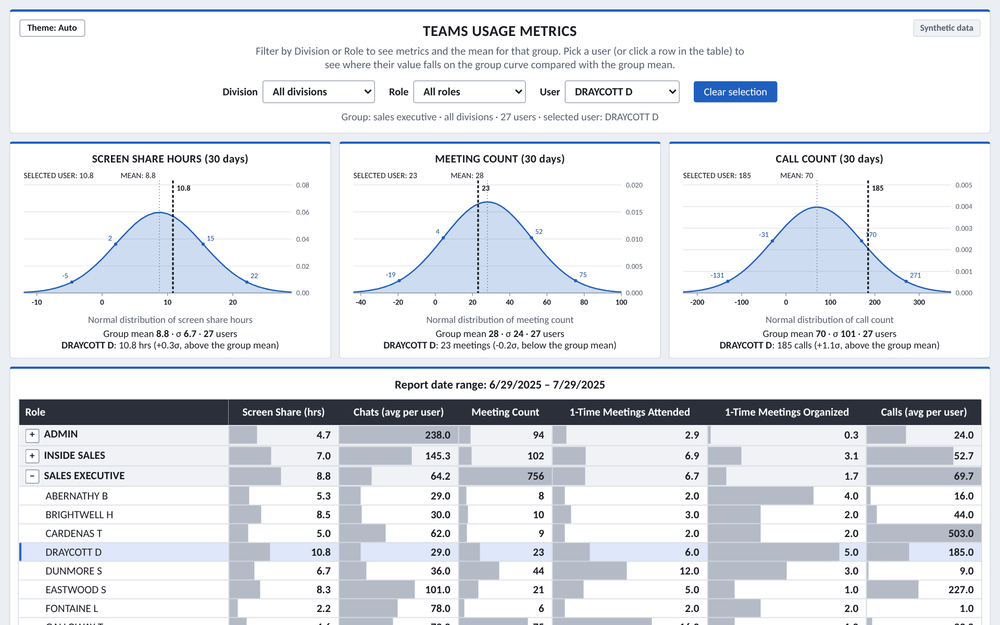
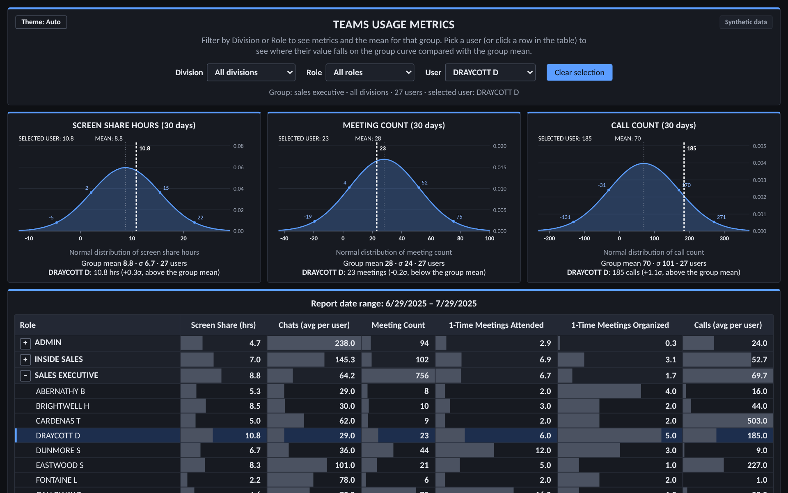

# Teams Usage Dashboard

An analytics dashboard that shows how each person's Microsoft Teams activity (screen sharing, meetings and calls) compares with the rest of their role group. Built in **Power BI** and recreated as an **interactive web page** so it can be viewed without Power BI.

**All data in this project is synthetic.** Names, IDs and numbers are invented for demonstration.

### [▶ Open the live dashboard](https://mishide.github.io/teams-usage-dashboard/)

| Light | Dark |
|---|---|
|  |  |

## The question it answers

*Is this person's activity typical for their role, or an outlier?*

A raw total can't answer that, because an admin and a sales executive use Teams very differently. Each chart draws the normal distribution of one metric for the selected group (role and/or division), marks the group mean, and places the selected person on the curve, so the answer reads at a glance in standard deviations.

## What you can do in the dashboard

- Filter by **Division** and **Role** to redraw all three curves for that group.
- Pick a **User** (or click a row in the table) to mark that person on every curve and see how many standard deviations they sit from the group mean.
- Expand a role in the table to compare people side by side, with data bars scaled per column.
- Hover a curve to read X, f(x) and the z-score. Switch between light and dark mode with the Theme button.

## Skills demonstrated

| Area | What's in this project |
|---|---|
| Data modeling | User lookup dimension related to a metrics fact table, date relationships, calculated helper tables |
| DAX | `ALLEXCEPT` group context, `STDEV.P`, a normal probability density function, calculated tables built with `CALENDAR` |
| Power Query | CSV import, header promotion, typed columns, removal of empty columns |
| Report design | Three distribution charts with reference lines, a matrix with data bars, consistent filters |
| Front end | Self-contained HTML, CSS and JavaScript (SVG charts, no libraries), light and dark themes, keyboard-accessible controls |

The key measures are written up in [docs/dax-measures.md](docs/dax-measures.md).

## Repository contents

```
index.html                       Interactive web version (served by GitHub Pages)
data/                            Synthetic CSV files used by the Power BI report
Teams Usage Dashboard/           Power BI project (PBIP format)
  Teams Usage Dashboard.pbip
  Teams Usage Dashboard.Report/          Pages and visuals
  Teams Usage Dashboard.SemanticModel/   Tables, measures, relationships, Power Query
docs/                            Screenshots and DAX notes
```

## Open the Power BI project

1. Install **Power BI Desktop** (Windows). If needed, turn on **File > Options and settings > Options > Preview features > Power BI Project (.pbip) save option**, then restart.
2. Download or clone this repository and save the CSV files from `data/` to a folder on your computer.
3. Open `Teams Usage Dashboard/Teams Usage Dashboard.pbip`.
4. Go to **Home > Transform data**, open the `Teams_Metrics` and `teamUserLookup` queries, and update the file path in the **Source** step to the folder where you saved the CSVs.
5. Click **Close & Apply** to refresh.

You can also read the measures and Power Query code directly on GitHub: they are plain-text `.tmdl` files under `Teams Usage Dashboard.SemanticModel/definition/`.

## Notes

- The web page is a recreation of the Power BI report in HTML. It uses the same logic (group mean and population standard deviation by role and division, with a normal curve drawn from mean − 3σ to mean + 3σ) but is not Power BI itself, so small visual differences are expected.
- Role rows in the table show per-user averages; Meeting Count is a total.

Built by [mishide](https://github.com/mishide).
